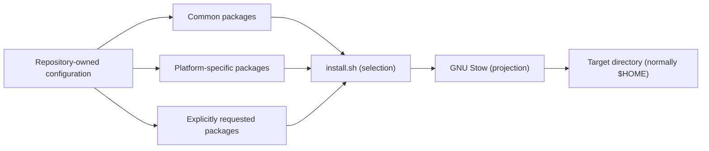

# Architecture

This document explains how this repository is designed: the boundaries
it keeps, the patterns it uses, and the invariants future changes
should preserve. For installation, see [README.md](README.md).

## Responsibility

This repository owns the desired state of a personal development
environment: shell and tool configuration, editor configuration, Git
configuration, desired Homebrew formulae, and the common/
platform-specific split between them. It also owns the mechanism that
projects that state into a target home directory.

Provisioning a machine from scratch and converging it toward this
desired state are someone else's job. A separate bootstrap process may
consume this repository as one input, but this repository doesn't
know about or depend on that process.

## Stow packages

GNU Stow packages are the unit of both ownership and deployment. Each
package directory mirrors the paths it installs, relative to the
target directory, so `git/.config/git/config` is projected to
`~/.config/git/config`. `install.sh` selects a set of packages for the
current platform and hands them to `stow`, which symlinks their
contents into the target (normally `$HOME`). See `install.sh` for the
current package sets rather than relying on an inventory here, since
that list changes independently of the architecture.

Stow is always invoked with `--no-folding` (set in `.stowrc` and
`install.sh`), so it links individual files rather than whole
directories. A target directory like `~/.config/git` can therefore
hold both repo-managed files and files this repository doesn't know
about (an out-of-repo `work` include, state an application writes at
runtime) without conflict. `.stowrc` ensures a bare `stow <package>`
run from the repository root uses the same Stow defaults as
`install.sh`.

## Package selection

`install.sh` composes three kinds of packages:

- **Common packages**, installed on every platform.
- **Platform packages**, installed only when the detected platform
  matches. These come in two flavors: packages that hold
  platform-specific *integration* for otherwise-common tools (for
  example, `macos/.config/git/platform` and `wsl/.config/git/platform`
  supply different Git credential helpers), and packages for
  applications that exist on only one platform (for example `kitty`
  and `linearmouse`, which are macOS-only applications).
- **Explicitly requested packages**, opted into per invocation and
  never installed by default (for example `claude` and `quilt`).

## Common versus platform-specific configuration

The central invariant: prefer a common package with runtime platform
detection over a platform-specific fork. A platform package should
hold only configuration that genuinely cannot be expressed in common
configuration — a different credential helper binary, a
platform-only clipboard integration — not a duplicate of logic that
could run everywhere.

Supported platform cases are macOS, WSL, and generic Linux. Generic
Linux gets common packages only; where a common package reads a
platform integration file that doesn't exist for it (see the Git
example below), that file's absence is the intended degradation, not
a gap to fill.

Examples of the pattern in this repository:

- **Fish** detects the platform at shell startup
  (`fish/.config/fish/conf.d/00-platform.fish`) and exports it as
  `$PLATFORM` for other configuration to consume, including
  out-of-repo personal or work dotfiles. Within this repository, Fish
  and Bash instead adapt by probing for a Homebrew prefix
  (`/opt/homebrew` vs. `/home/linuxbrew/.linuxbrew`) rather than
  branching on `$PLATFORM`, since that's the thing that actually
  varies.
- **Git** composes a common `config` with a platform-specific
  `[include] path = platform`. On generic Linux, where no platform
  package is installed, the include points at a file that doesn't
  exist and Git silently skips it.
- **Neovim** centralizes platform-dependent editor behavior in
  `lua/config/platform.lua` (currently the WSL clipboard integration)
  rather than duplicating editor configuration per platform.

Git's `includeIf "gitdir:~/work/"` and Fish's `$PLATFORM` also serve
as extension points for configuration this repository doesn't own —
work-specific or otherwise private overlays apply through them
without this repository needing to know they exist.

## Configuration ownership and composition

- **`brew-formulae.txt`** is this repository's record of desired
  Homebrew formulae. Nothing in this repository installs from it;
  it's a declaration for whatever external process converges a
  machine's installed packages, not a script this repository runs
  itself.
- **EditorConfig is preferred** for cross-editor formatting and
  whitespace behavior wherever it can express the requirement.
  Editor-specific configuration (Vim/Neovim ftplugins, etc.) is
  reserved for behavior EditorConfig has no vocabulary for. Two
  EditorConfig files exist for two different scopes: the root
  `.editorconfig` governs editing this repository itself, while
  `editorconfig/.editorconfig` is a separate package stowed into
  `$HOME` as a global fallback for projects that have none of their
  own.
- **Neovim is the primary editor; Vim is a lean fallback.** Vim's
  configuration intentionally backports a small set of essentials
  (fuzzy completion, cursor restoration) rather than growing a
  parallel plugin ecosystem, so it stays usable wherever Neovim isn't
  available without becoming a second editor to maintain.
- **Git hooks are installed globally** via `core.hooksPath` in the
  `git` package, so the commit-message formatting this repository
  requires is enforced the same way in every repository on the
  machine, not just this one. The hook's own rules belong in the hook
  script and its tests, not here.

## Installation flow

`install.sh` operates in a fixed sequence:

1. Determine the host platform.
2. Determine the package set: common packages, platform packages for
   the detected platform, and any explicitly requested packages
   (skipping ones whose directory doesn't exist).
3. Build the Stow invocation for the target directory.
4. Apply it, symlinking the selected packages into place.
5. Run post-install actions narrowly scoped to what was just
   installed (for example, rebuilding `bat`'s theme cache only when
   the `bat` package was installed and `bat` is on `PATH`).

Exact flags, environment variables, and package names are operational
detail that changes independently of this flow; see
`./install.sh --help` for those.

## Where changes belong

| Change | Location |
|--------|----------|
| Default-installed Stow package | `install.sh` package arrays |
| Config only one platform needs | A platform package (`macos/`, `wsl/`), only once it can't be expressed as common config plus runtime detection |
| Config any platform can run | A common package, with runtime detection if behavior must vary |
| Cross-editor whitespace or formatting rule | EditorConfig: the root `.editorconfig` for this repository, the `editorconfig` package for the global fallback it stows |
| Desired Homebrew formula | `brew-formulae.txt` |
| Git hook behavior | `git/.config/git/hooks/` |
| Platform-dependent editor behavior | `neovim/.config/nvim/lua/config/platform.lua` |
| Private or work-specific overlay | Outside this repository, through the Git `work` include or Fish's `$PLATFORM` |
